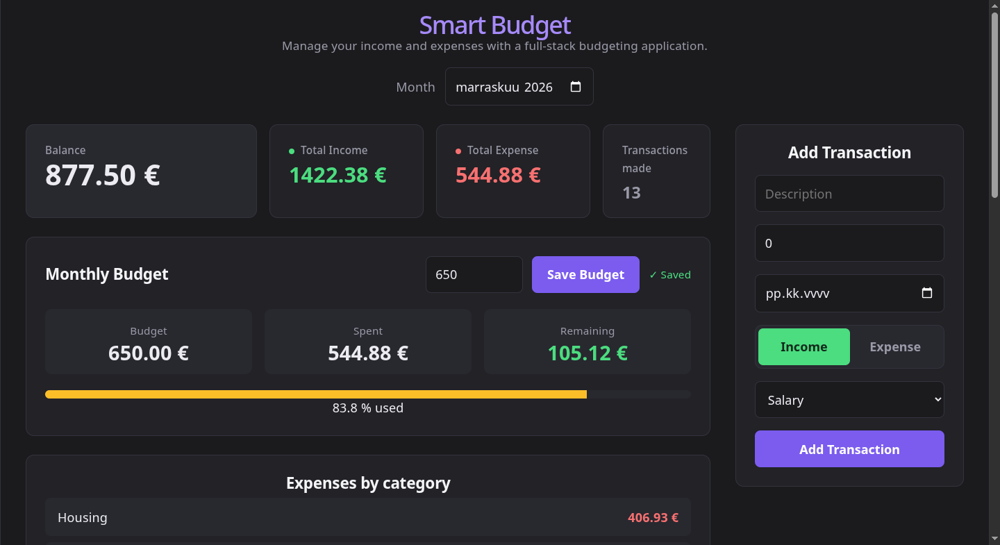

# SmartBudgetApp

A full-stack personal finance management application built with React, TypeScript, Node.js, Express and PostgreSQL.

SmartBudget helps users track income and expenses, manage monthly budgets and gain insights into spending habits through an intuitive dashboard interface.

---

## Screenshots



---

## Features

### Transaction Management

- Create transaction
- Edit transaction
- Delete transaction
- Income and expense tracking
- Category-based transactions

### Monthly Analytics

- Monthly transaction filtering
- Total income overview
- Total expense overview
- Balance calculation
- Expense categorization

### Budget Tracking

- Monthly budgets
- Budget persistence in PostgreSQL
- Budget usage tracking
- Remaining budget calculation
- Budget warning state
- Over-budget detection

### User Experience

- Responsive dashboard layout
- Loading states
- Saving states
- Unsaved changes detection
- Component-based architecture

---

## Technology Stack

### Frontend

- React
- TypeScript
- Vite
- CSS

### Backend

- Node.js
- Express
- TypeScript

### Database

- PostgreSQL

### Development Tools

- Git
- Github

---

## Architecture

```text
React + TypeScript
        │
        ▼
Express REST API
        │
        ▼
PostgreSQL
```

--- 

## Project Structure

```text
smartbudget/
│
├── frontend/
│   ├── src/
│   │   ├── components/
│   │   │   ├── BudgetCard.tsx
│   │   │   ├── CategorySummary.tsx
│   │   │   ├── DashboardCards.tsx
│   │   │   ├── TransactionForm.tsx
│   │   │   └── TransactionTable.tsx
│   │   │
│   │   ├── types/
│   │   ├── App.tsx
│   │   └── App.css
│
├── backend/
│   ├── src/
│   │   ├── routes/
│   │   │   ├── budgets.ts
│   │   │   └── transactions.ts
│   │   │
│   │   ├── db/
│   │   └── server.ts
│
└── README.md
```

## Roadmap

### Completed ✅

- [x] Transaction CRUD
- [x] PostgreSQL integration
- [x] Transaction categories
- [x] Monthly filtering
- [x] Expense category analytics
- [x] Monthly budget system
- [x] Budget persistence
- [x] Budget progress tracking
- [x] Warning and over-budget states
- [x] Component-based frontend architecture

### In Progress

- [ ] Budget vs Actual comparison
- [ ] Monthly trend analysis
- [ ] Improved dashboard insights

### Planned

- [ ] Financial goals
- [ ] Savings tracking
- [ ] User authentication
- [ ] Cloud deployment
- [ ] Docker support
- [ ] CI/CD pipeline
- [ ] Automated testing

---

## Purpose

This project is being developed as a portfolio project to demonstrate modern full-stack development skills including:

- Frontend development with React and TypeScript
- REST API design with Express
- PostgreSQL database design
- Component architecture
- State management
- Financial data aggregation and analytics
- Full-stack application development

---

## Author

Niklas Ekman

GitHub: https://github.com/mrduckos


